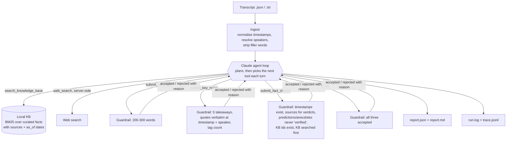

# Podcast agent

An agentic AI system that turns raw podcast transcripts into publishable content for an ad agency. For each episode it:

1. **Summarises** the episode in 200-300 words: core themes, key discussions, and what each speaker concluded.
2. **Extracts show notes**: 🔹 top 5 takeaways, 💬 notable quotes with timestamps, 🧭 topic tags.
3. **Fact-checks** the claims made in the episode against a local knowledge base and live web search. Each claim is marked ✅ verified, ⚠️ possibly outdated/inaccurate or ❓ unverifiable, with a confidence score and sources.

It runs in Docker and calls **GLM-5.3-flash (`z-ai/glm-5.3-flash`) through OpenRouter** by default, a reasoning model with tool calling at $0.15/$0.50 per million tokens. Any other OpenRouter model, or Claude through the Anthropic API, is a one-line config change. Every reasoning step is logged: the plan, the model's reasoning, tool calls, guardrail rejections and web searches.

- Architecture design (components, control loop, guardrails, data model, trade-offs): [design/ARCHITECTURE.md](design/ARCHITECTURE.md) ([PDF](design/ARCHITECTURE.pdf))
- Deployment strategy (diagram and narrative): [design/DEPLOYMENT.md](design/DEPLOYMENT.md)
- Sample outputs: [outputs/](outputs/) (`index.md`, plus `report.md`, `report.json`, `run.log` and `trace.jsonl` for each episode)

---

## Quick start (Docker)

Requirements: Docker and an [OpenRouter API key](https://openrouter.ai/keys).

```bash
cp .env.example .env              # then put your key in OPENROUTER_API_KEY
docker compose build
docker compose run --rm agent     # processes all three sample transcripts
```

Results are written to `./outputs/` on the host:

```
outputs/
├── index.md                 # one-line summary per episode, with cost
├── all_reports.json
└── ep001/
    ├── report.md            # summary, notes and fact-check table (human-readable)
    ├── report.json          # the same content, structured
    ├── run.log              # the agent's reasoning trace, readable
    └── trace.jsonl          # the same trace, one JSON event per line
```

Other useful commands:

```bash
docker compose run --rm agent run --episodes ep002            # one episode
docker compose run --rm agent run --no-web                    # knowledge base only, no web search
docker compose run --rm agent run --effort low --concurrency 3
docker compose run --rm agent run --model anthropic/claude-sonnet-5.5     # any OpenRouter model id
docker compose run --rm agent run --input data/transcripts/my_show.txt
docker compose run --rm agent kb-search "FDA autonomous AI"   # query the KB directly
docker compose run --rm --entrypoint pytest agent -q          # offline test suite (no API key needed)
```

The same commands are in the `Makefile` (`make build`, `make run`, `make run-ep EP=ep002`, `make test`).

Without Docker Compose, use plain Docker:

```bash
docker build -t podcast-agent .
docker run --rm -t --env-file .env -v "$PWD/outputs:/app/outputs" podcast-agent
docker run --rm -t --env-file .env -v "$PWD/outputs:/app/outputs" podcast-agent run --episodes ep002 --no-web
```

### Without Docker

Python 3.10+:

```bash
python3 -m venv .venv && source .venv/bin/activate
pip install -e ".[dev]"
cp .env.example .env   # add OPENROUTER_API_KEY; the CLI reads .env
podcast-agent run
pytest -q
```

---

## What a run looks like

An excerpt from the real `outputs/ep002/run.log` (long lines trimmed). The agent plans, gets nudged after stopping too early, searches the knowledge base, submits, has its fact-check table rejected by a guardrail, fixes it and finishes:

```
[   0.0s] ep002     INFO   | Starting 'AI in Healthcare: Hype or Reality?' (16 segments) with z-ai/glm-5.3-flash, effort=high, web_search=on
[  29.5s] ep002 t01 PLAN   | 1. I will summarize the episode's themes, ensuring it is between 200 and 300 words.
[  29.5s] ep002 t01 INFO   | No tool call this turn; nudging agent. You stopped without finishing. Still needed: submit_summary, submit_key_notes, submit_fact_checks. Continue.
[  36.2s] ep002 t02 TOOL   | search_knowledge_base({"query": "FDA review AI medical devices autonomous diagnostics"})
[  36.2s] ep002 t02 RESULT | search_knowledge_base -> {"results": [{"id": "kb-health-001", "statement": "The FDA maintains a public list of AI-enabled medical devices it has authorized; the list passe …
[  53.3s] ep002 t04 TOOL   | submit_summary({"summary": "In this episode of Tech Health Today, host David Chen explores whether AI in healthcare is hype or reality, weighing the technology's current u …
[  53.3s] ep002 t04 RESULT | submit_summary -> {"accepted": true, "word_count": 246}
[  61.9s] ep002 t05 RESULT | submit_key_notes -> {"accepted": true, "takeaways": 5, "quotes": 4, "topics": ["ai-diagnostics", "fda-regulation", "triage-chatbots", "algorithmic-bias", "data-privacy", " …
[  84.9s] ep002 t06 REJECT | submit_fact_checks: Fact checks rejected:
- Claim 5: you recorded counter-evidence ("The McKinsey source documents digital health/telehealth adoption specifically; the 'including AI tools' extension is supported only indirectly."), so it cann …
[ 105.4s] ep002 t07 RESULT | submit_fact_checks -> {"accepted": true, "claims": 6, "by_status": {"verified": 4, "possibly_inaccurate": 1, "unverifiable": 1}}
[ 110.9s] ep002     DONE   | Completed in 110.9s: 8 turns, 11 tool calls, 1 guardrail rejections, 0 web searches, ~$0.0052
```

The full trace, including the model's reasoning at each turn, is in [outputs/ep002/run.log](outputs/ep002/run.log).

---

## Architecture



### Components

| File | Role |
|---|---|
| [src/podcast_agent/ingest.py](src/podcast_agent/ingest.py) | Loads `.json` (the provided format) and `.txt` (`[00:02:14] Host: ...`) transcripts. Normalises timestamps to `HH:MM:SS`, maps labels like "Dr. Priya" to full names from the episode metadata, and removes disfluencies ("um", "uh", stutters) while keeping the raw text. |
| [src/podcast_agent/agent.py](src/podcast_agent/agent.py) | The agent loop and system prompt. Calls Claude with the tools, logs every content block, runs client tools, sends results back, and stops on `finish` or the turn budget. Handles `pause_turn`, refusals, `max_tokens`, and missing web search access. |
| [src/podcast_agent/tools.py](src/podcast_agent/tools.py) | Tool schemas (strict JSON schemas) and handlers. The `submit_*` handlers are the guardrails. |
| [src/podcast_agent/kb.py](src/podcast_agent/kb.py) + [data/knowledge_base.json](data/knowledge_base.json) | The local knowledge base: about 20 curated reference statements, each with a source URL and an `as_of` date, searched with BM25. |
| [src/podcast_agent/trace.py](src/podcast_agent/trace.py) | Console, `run.log` and `trace.jsonl` output. |
| [src/podcast_agent/render.py](src/podcast_agent/render.py) | Markdown and JSON reports, plus the run index. |
| [config.yaml](config.yaml) | Every tunable: model, effort, limits, web search, prices for cost estimates. |

### Why it is built this way

**The agent decides the order of work, the code decides what counts as done.** Claude gets the transcript and five tools (plus web search). It writes its own plan, chooses which claims are worth checking, how to query the KB, when the KB is not enough and a web search is needed, and in what order to submit. What it does not get to decide is quality. Each `submit_*` tool checks the submission against the transcript and the configured limits, and a rejection names exactly what to fix (for example "Quote 3 does not appear verbatim at 00:04:15; that line reads: ..."). The agent revises and resubmits. That gives the autonomy the task asks for without trusting the model on the things that are cheap to check in code: word counts, verbatim quotes, timestamps and speakers, citation presence.

**Quotes are checked word for word.** Show notes go out under a client's name, and a misattributed or paraphrased quote is the most damaging error this system could make. Every quote must appear verbatim in the transcript line at its timestamp, spoken by the named speaker. Punctuation, curly quotes and case are ignored, and `...` may join two parts of the same line.

**Fact-checking is retrieval first, then the web, with dated evidence.** The KB is the agency's trusted, curated source. Each entry has an `as_of` date so the agent can tell a confirmed fact from one that may have gone stale. Web search covers what the KB doesn't. The verdict rules are deliberately conservative:

- `verified` needs a source that says the same thing. A related source is not enough, and a verdict can't be upgraded on plausibility alone.
- `possibly_inaccurate` covers contradicted, outdated *and overstated* claims. In ep002, "full autonomy isn't happening anytime soon" sits against the FDA's 2018 authorisation of IDx-DR, an autonomous diagnostic.
- Predictions and personal anecdotes ("we reached break-even in 18 months") are still listed, classified, and marked `unverifiable`, never `verified`. The code enforces this, not only the prompt.
- Every claim records `counter_evidence`: anything found that contradicts or qualifies it. A claim with counter-evidence can't be `verified`. I added this rule after an early run where the model noted the IDx-DR counterexample in its own notes but still marked the claim ✅. Forcing the model to state counter-evidence explicitly, and checking it in code, closed that gap.

**Confidence** is how strongly the evidence supports the verdict (about 0.85-0.95 for a direct authoritative source, 0.3-0.5 for unverifiable), which matches the scale in the brief's example table.

**Model choice.** The brief allows any locally hosted or cloud model. The default is `z-ai/glm-5.3-flash` on OpenRouter at reasoning effort `high`: it handles multi-step tool use well and costs about a cent per episode, so the guardrails, not the model's size, carry the quality bar. Both providers are called through the Anthropic Messages API (OpenRouter serves it for every model and maps `thinking`/`effort` onto each model's own reasoning controls), so there is one agent loop regardless of model. To compare models, change `--model`. With `provider: anthropic` you also get Anthropic-only features: prompt-cache control, summarised thinking, and server-side refusal fallback.

**I wrote the loop by hand rather than using the SDK's beta tool runner**, so every content block (thinking, text, server-side web search, tool calls, rejections) can be logged in order, and so stop reasons (`pause_turn`, `refusal`, `max_tokens`) and turn budgets are handled explicitly.

**Settings live in `config.yaml`, not environment variables.** The environment holds only the API keys (`OPENROUTER_API_KEY`, optionally `ANTHROPIC_API_KEY`). In production the same settings move to an admin-editable database table (see [design/DEPLOYMENT.md](design/DEPLOYMENT.md#configuration)).

---

## Configuration

All behaviour is in [config.yaml](config.yaml). The CLI overrides the common ones (`--model`, `--effort`, `--no-web`, `--concurrency`).

| Setting | Default | Notes |
|---|---|---|
| `model.provider` | `openrouter` | `openrouter` or `anthropic` |
| `model.name` | `z-ai/glm-5.3-flash` | Any OpenRouter model id (e.g. `anthropic/claude-sonnet-5.5`), or a Claude id with `provider: anthropic` |
| `model.effort` | `high` | GLM-5.3-flash accepts `low`, `high`, `max` |
| `model.show_thinking` | `true` | Log the model's reasoning |
| `agent.max_turns` | `30` | Turn budget. If it runs out, the report is saved and marked incomplete |
| `agent.summary_min_words` / `summary_max_words` | `200` / `300` | Enforced by `submit_summary` |
| `agent.takeaways_count` | `5` | Enforced exactly |
| `agent.min_quotes` / `max_quotes` | `3` / `6` | |
| `agent.min_claims` / `max_claims` | `5` / `12` | Size of the fact-check table |
| `fact_check.web_search` | `true` | Server-side web search (`openrouter:web_search`; Exa for GLM, about $0.012 per search). If the provider rejects it, the run logs a warning and continues with the KB only |
| `fact_check.web_search_max_uses` | `8` | Per model request |
| `fact_check.web_search_engine` | `auto` | OpenRouter: `auto`, `native`, `exa`, `parallel`, `perplexity` |
| `concurrency` | `1` | Episodes in parallel; output lines are prefixed with the episode id |

## Output format

`report.json` (abridged):

```json
{
  "episode_id": "ep002",
  "title": "AI in Healthcare: Hype or Reality?",
  "summary": "...",
  "key_notes": {
    "takeaways": ["...", "...", "...", "...", "..."],
    "quotes": [{"timestamp": "00:00:55", "speaker": "Dr. Priya Patel", "quote": "But it's assistive, not replacing clinicians."}],
    "topics": ["ai-diagnostics", "fda-regulation", "data-privacy"]
  },
  "fact_checks": [
    {
      "claim": "The FDA reviews AI systems carefully, so full autonomy is not happening anytime soon.",
      "timestamp": "00:01:15", "speaker": "Alex Moore",
      "claim_type": "prediction", "status": "possibly_inaccurate", "confidence": 0.8,
      "verification": "Overstated (autonomous AI already exists)",
      "evidence": "...", "counter_evidence": "FDA authorised IDx-DR, an autonomous diagnostic, in 2018",
      "sources": ["kb-health-002"]
    }
  ],
  "run": {"model": "z-ai/glm-5.3-flash", "agent_turns": 8, "tool_calls": 11, "validation_rejections": 1,
          "web_searches": 0, "estimated_cost_usd": 0.0052, "completed": true, "plan": "1. ..."}
}
```

`report.md` renders the same content with the fact-check table from the brief (Claim / Verification / Confidence, with ✅ ⚠️ ❓), an evidence list with links, and the run details.

## Tests

`pytest -q` runs 17 offline tests, with no API key needed:

- Ingest: timestamp normalisation, filler removal, speaker resolution, `.txt` parsing including wrapped lines.
- KB retrieval ranking.
- Every guardrail: word limits, invented quotes, wrong speaker, takeaway count, sources required, predictions can't be verified, unknown KB ids, KB must be searched before verdicts, and `finish` before completion.
- The agent loop, driven by a scripted fake client: it recovers from a rejection, finishes, counts turns and tool calls correctly, and nudges the agent when it stops early.

## Adapting it

| Change | Where |
|---|---|
| Different summary length, number of takeaways, claim count | `config.yaml` |
| New output (e.g. YouTube chapters, ad-read suggestions) | Add a `submit_*` tool and validator in `tools.py`, add the field to `EpisodeReport`, and include it in `AgentState.missing()`. The agent's plan picks up the new tool. |
| New transcript format (SRT, VTT, diarised JSON) | Add a loader in `ingest.py` that returns an `Episode` |
| Different or larger knowledge base | Replace `KnowledgeBase.search` with a vector or OpenSearch query that returns the same fields |
| Different model or provider | `model.name` / `model.provider` in config. For Bedrock, add a branch in `make_client` (`cli.py`) returning `AnthropicBedrockMantle` (same `messages` API) |
| Stricter or looser fact-checking | Verdict rules are in `SYSTEM_PROMPT` (agent.py) and enforced in `handle_submit_fact_checks` (tools.py) |

## Limitations and next steps

- The knowledge base is a small curated mock (about 20 entries) covering these three episodes' domains. In production it would be the agency's research store, and editor-approved verdicts would be written back to it.
- Confidence scores are the model's judgement guided by a rubric, not a calibrated probability. The next step is an eval set of labelled claims to measure verdict accuracy and calibrate.
- Web search results are logged (queries, titles, URLs), but the evidence text the agent read is summarised in `evidence` rather than stored in full.
- Transcripts this short fit in one context window. For multi-hour episodes, see the chunking note in [design/DEPLOYMENT.md](design/DEPLOYMENT.md#scalability).
