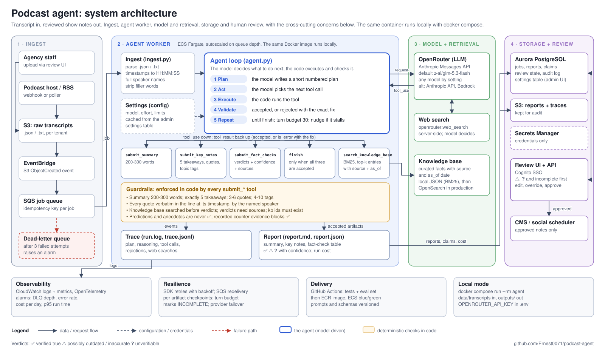
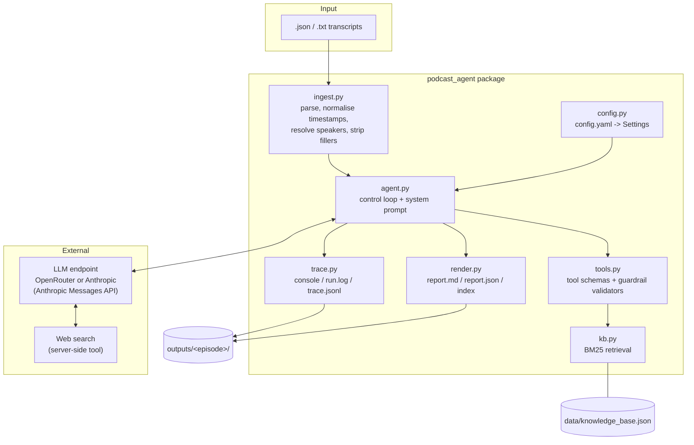
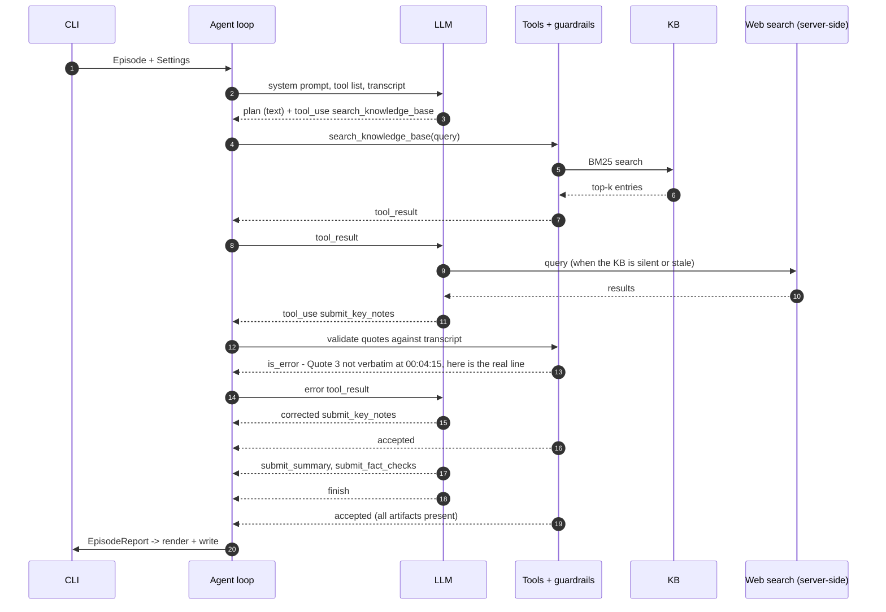
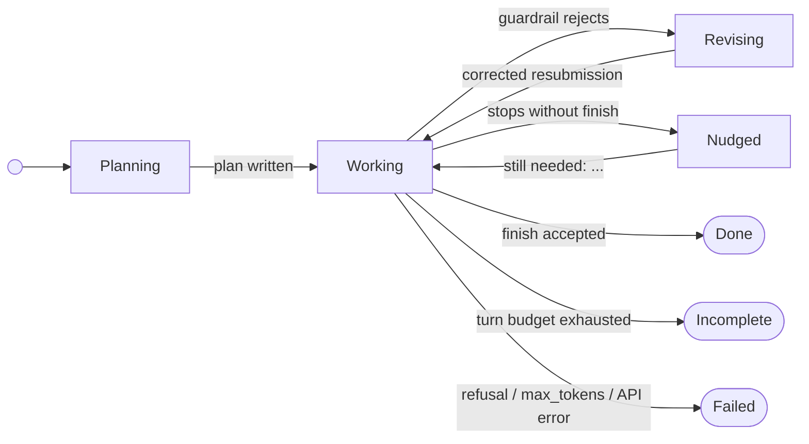
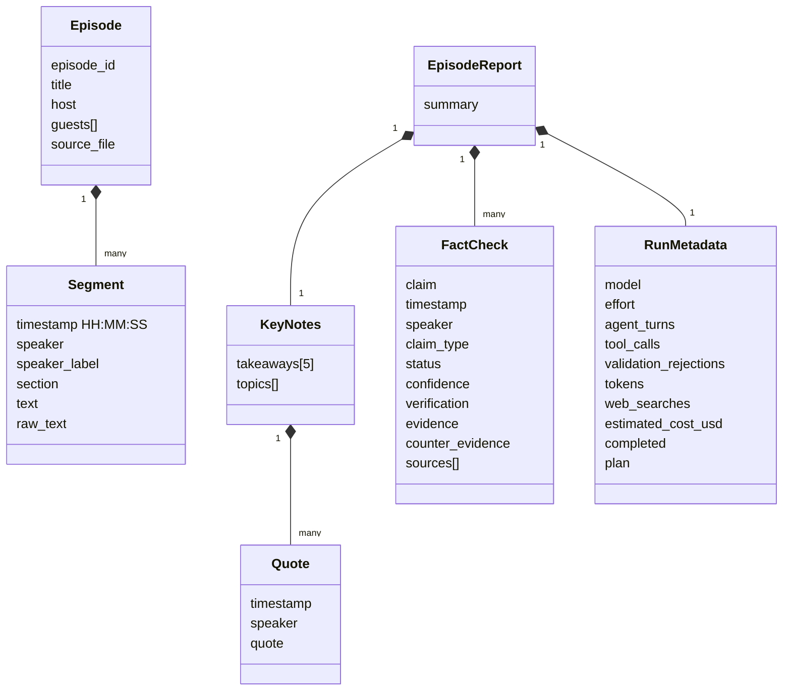

# Architecture design

This document describes how the agent itself is built: its components, the control loop, how it plans and recovers, the data it produces, and the trade-offs behind each choice. Production infrastructure (queues, workers, storage, scaling and cost) is covered in [DEPLOYMENT.md](DEPLOYMENT.md).

## System overview

One diagram of the whole system: how a transcript enters, how the agent works on it, which services it calls, where results are stored and reviewed, and the cross-cutting concerns (observability, resilience, delivery, local mode). The sections below zoom into each part.

Also available as [PNG](architecture-overview.png) for slides.

## 1. Goals and constraints

| Requirement (from the brief) | Design response |
|---|---|
| Summarise each episode (~200-300 words) | `submit_summary` tool, word count enforced in code |
| Top 5 takeaways, quotes with timestamps, topic tags | `submit_key_notes` tool. Quotes are matched verbatim against the transcript line at that timestamp and speaker |
| Fact-check claims with retrieval, a KB or reasoning; mark ✅ ⚠️ ❓ with confidence | `search_knowledge_base` (local BM25 KB) plus server-side web search, then `submit_fact_checks` with verdict rules enforced |
| A multi-step agent that plans and executes autonomously | The LLM writes its own plan and chooses every tool call. Code only validates and executes |
| Readable logs of reasoning steps and plans | `run.log` and `trace.jsonl`: plan, reasoning, tool calls, rejections, searches |
| Model available locally or on a cloud provider | OpenRouter (default: `z-ai/glm-5.3-flash`) or the Anthropic API, chosen by one setting |
| Runs locally in Docker | Single image; `docker compose run --rm agent` |

Non-goals for this version: audio transcription, a web UI, and persistence beyond files. These belong to the production design in DEPLOYMENT.md.

## 2. Component view

| Module | Responsibility | Depends on |
|---|---|---|
| `ingest.py` | Turns any supported transcript into an `Episode` with `HH:MM:SS` timestamps, full speaker names and cleaned text, keeping the raw text | `models` |
| `agent.py` | Builds requests, runs the turn loop, logs every content block, dispatches tool calls, enforces the turn budget, handles stop reasons | `tools`, `trace`, `config` |
| `tools.py` | Declares tools as strict JSON schemas. Handlers validate submissions and mutate `AgentState` | `kb`, `models` |
| `kb.py` | Ranks curated KB entries for a query (BM25), returning id, statement, source, url, as_of and relative relevance | none |
| `trace.py` | One event API, three sinks: coloured console, plain `run.log`, structured `trace.jsonl` | `rich` |
| `render.py` | Report Markdown (with the brief's fact-check table) and JSON, plus the cross-episode index | `models` |
| `config.py` | Typed settings with defaults; maps provider to credential variable and base URL | `pydantic` |

## 3. The control loop

The agent is a tool-use loop: the model decides, the code executes and validates. Nothing in the code fixes the order of steps.

### Run states

- **Done**: all three artifacts are accepted and `finish` is called. The report is written.
- **Incomplete**: `max_turns` ran out. The partial report is written with `completed: false` and a banner, so a human sees it instead of losing it.
- **Failed**: a refusal, `max_tokens`, or an unrecoverable API error. The episode is reported as failed and the other episodes continue.
- If the provider rejects the web search tool, the loop drops it, logs a warning and continues with the KB only.

## 4. Guardrails: the code decides what counts as done

The model has autonomy over *how* to do the work. Code decides whether the result is acceptable. Each rule below is cheap to check in code and costly to get wrong in front of a client.

| Tool | Rule | Why |
|---|---|---|
| `submit_summary` | 200-300 words (configurable) | Brief requirement; models drift on length |
| `submit_key_notes` | Exactly 5 takeaways; 3-6 quotes; 4-10 distinct tags (kebab-cased) | Brief requirement and consistent layout |
| | Each quote verbatim in the line at its timestamp; speaker must match | A misquote or misattribution under a client's name is the worst failure mode |
| `submit_fact_checks` | KB must have been searched at least once | Forces retrieval before verdicts |
| | Every timestamp exists; speaker is taken from the transcript | No invented attributions |
| | `verified` / `possibly_inaccurate` need at least one source | No unsupported verdicts |
| | Predictions and personal anecdotes can never be `verified` | They can't be confirmed, whatever the model believes |
| | Cited `kb-` ids must exist | No invented citations |
| | A claim with recorded `counter_evidence` can't be `verified` | Stops "supporting source found, contradiction ignored" |
| `finish` | All three artifacts accepted | No early exit |

Rejections come back as `is_error` tool results that name the exact fix (for example the real text of the line the quote should come from). In practice the model corrects itself in one turn. Rejection counts are recorded per run as a quality signal.

## 5. Fact-checking design

1. **Claim selection** is done by the model, guided by the prompt: statements about the world (organisations, statistics, regulation, history), plus predictions and anecdotes stated as fact, which are classified as such. Pure opinions are skipped.
2. **Retrieval first.** The local KB is the agency's trusted, curated source. Each entry has a source URL and an `as_of` date, so the model can judge staleness against today's date.
3. **Web search as a fallback** when the KB is silent or stale. It runs server-side (OpenRouter's `openrouter:web_search`, or Anthropic's `web_search` tool), so the model chooses when to search and the loop needs no search client of its own.
4. **Verdict rules:** verified only when a source states the claim; possibly_inaccurate for contradicted, outdated or overstated claims; unverifiable for predictions, private anecdotes or no evidence.
5. **Confidence** measures how strongly the evidence supports the verdict, with a rubric in the prompt.

## 6. Data model

Every output field is typed with pydantic, so `report.json` has a stable schema for downstream systems (CMS, review UI, analytics).

## 7. Model and provider abstraction

Both supported providers speak the Anthropic Messages API, so there is one loop and one message format:

- **OpenRouter** (default) at `https://openrouter.ai/api`, authenticated with `OPENROUTER_API_KEY`. It routes to any model, and OpenRouter maps the request's `thinking` and `effort` fields onto each model's own reasoning controls. The default is `z-ai/glm-5.3-flash` ($0.15/$0.50 per million tokens): a cheap reasoning model with reliable tool calling. Changing `model.name` switches to `anthropic/claude-sonnet-5.5`, a GPT model, or any other.
- **Anthropic API** (`provider: anthropic`) for Anthropic-only features: prompt-cache control, summarised thinking display, and server-side refusal fallback.

Changing model or provider is a settings change, not a code change. That matters for evals: the same transcript set can be run across models and compared on rejection rate, verdict accuracy and cost.

## 8. Observability

Every content block the model returns becomes a trace event: `PLAN` (first text), `THINK` (reasoning), `AGENT` (narration between steps), `TOOL`, `RESULT`, `REJECT`, `SEARCH` and `DONE`. The same event goes to the console (coloured), `run.log` (greppable) and `trace.jsonl` (machine-readable, ready to ship to a log pipeline). Run metadata records turns, tool calls, rejections, tokens, searches, cost (as reported by OpenRouter) and the plan.

## 9. Key decisions and trade-offs

| Decision | Alternative considered | Why this one |
|---|---|---|
| Model-driven tool loop | Fixed pipeline (summarise -> extract -> check) | The brief asks for autonomous planning; the model adapts which claims to check and when to search. Guardrails keep quality deterministic anyway |
| Validation inside the tools | A separate "critic" LLM pass | Code checks are free, exact and explainable. An LLM critic adds cost and its own errors |
| Hand-written loop | SDK tool runner / agent framework | Full control of logging, stop reasons, turn budget and provider differences in about 150 lines |
| Anthropic Messages API over OpenRouter | OpenAI chat-completions format | One format for both providers; OpenRouter normalises reasoning and server tools across models |
| BM25 over a curated JSON KB | Vector DB | The KB is small and keyword-heavy (entity names, dates). BM25 is transparent and dependency-free, and the interface swaps cleanly for OpenSearch or pgvector |
| Server-side web search | Own search client (SerpAPI, Tavily) | No extra key or code; the model controls when and how often to search |
| Settings in `config.yaml` | Environment variables | Behaviour stays reviewable and versioned. The environment holds secrets only. In production the same fields live in an admin-editable settings table |

## 10. Extension points

- **New artifact**: add a `submit_*` tool and validator, a field on `EpisodeReport`, and an entry in `AgentState.missing()`. The model's plan adapts on its own.
- **New input format**: add a loader returning an `Episode`.
- **New retrieval source**: implement `search(query, top_k)` returning the same fields.
- **New model**: change `model.name`; no code changes.
