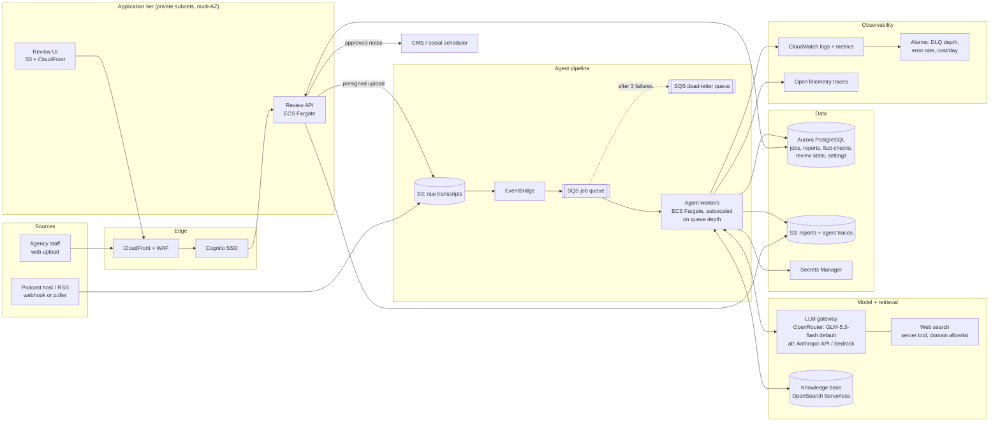

# Deployment strategy

How I would run the podcast agent in production for an ad agency: many clients, many shows, a content team that reviews output before it is published, and a budget that someone watches.

The reference design uses AWS. Every component has a direct equivalent on GCP or Azure. Model calls go through OpenRouter by default (one key, any model, automatic provider failover), with the Anthropic API or Amazon Bedrock as alternatives for clients who need inference under a direct contract or inside their own cloud account.

## Diagram

## Request lifecycle

1. **Ingest.** A transcript arrives through a presigned S3 upload from the review UI, or from a podcast host webhook or RSS poller. The object key carries the tenant (client) and show IDs.
2. **Queue.** The S3 `ObjectCreated` event goes through EventBridge to an SQS queue. The message holds the S3 key plus an idempotency key, a hash of the transcript and the settings version.
3. **Run the agent.** A Fargate worker takes the message, loads the transcript, and runs the same agent loop as the local container: plan, summarise, extract notes, check the knowledge base, use web search where needed, submit, finish. Each accepted artifact is written to Postgres as soon as it passes validation, so a crash mid-run resumes from the last accepted artifact instead of starting over.
4. **Persist.** `report.json`, `report.md`, `run.log` and `trace.jsonl` go to S3. Structured rows (report, claims, verdicts, cost, token use) go to Postgres.
5. **Human review.** Editors see the report in the review UI. Claims marked ⚠️ or ❓, and any run flagged incomplete, go to the top of the queue. Editors can edit text, override a verdict (with a reason that is kept), and approve.
6. **Publish.** Approved show notes and social highlights go to the agency's CMS or social scheduler by webhook. Nothing is published without approval: the agent drafts and an editor signs off.

## Non-functional considerations

### Scalability

- **Queue-based and horizontal.** Workers are stateless. ECS Service Auto Scaling tracks `ApproximateNumberOfMessagesVisible` per worker, scales to zero overnight, and bursts when a client drops a season's back catalogue.
- **The real ceiling is model rate limits, not compute.** One episode needs about 10 model calls over 1-3 minutes and almost no CPU. Worker count is capped so tokens per minute stay under the account's limit. A per-tenant token bucket stops one client's backlog from starving everyone else.
- **Backlogs go to the Batch API.** Bulk jobs where nobody is waiting (a 200-episode back catalogue, say) can run the single-shot steps through the Message Batches API at half price, while interactive uploads keep the live path.
- **Long transcripts.** Today's transcripts are about 1-2K tokens. A 2-hour episode is about 25-30K tokens, well within the context window. Past that, the worker summarises section by section and the agent works from those section summaries plus targeted retrieval over the full transcript.

### Fault tolerance

| Failure | Handling |
|---|---|
| Model API 429 / 5xx / network | SDK retries with exponential backoff (`max_retries=4`). Beyond that the job goes back to SQS and is retried with backoff. |
| Upstream provider outage | OpenRouter routes the same model to another upstream provider automatically. If OpenRouter itself is down, `model.provider` flips to the Anthropic API (or Bedrock) through the settings table, with no deploy. |
| Model refusal | The job is marked `needs_review` instead of retrying. On the Anthropic provider, the server-side refusal fallback reruns the turn on a fallback model first. |
| Worker crash / deploy mid-run | The SQS visibility timeout returns the message to the queue. Accepted artifacts are checkpointed, so the retry resumes. The idempotency key prevents a duplicate report. |
| Poison message (bad file) | After 3 receives it goes to the DLQ, which raises an alarm. Ingestion errors are shown to the uploader in the UI. |
| Agent loops without finishing | The turn budget (`max_turns`) ends the run. The partial report is saved and flagged `INCOMPLETE` for a human. |
| Low-quality output | Guardrails in the tools reject it before it is accepted: summary word count, exactly 5 takeaways, quotes matched verbatim to their timestamp and speaker, sources required for verdicts, predictions never "verified". |
| Web search unavailable | The run falls back to the knowledge base only, and this is recorded in the run metadata. |

Aurora and S3 are multi-AZ. Workers run across at least 2 AZs. RPO is about 0 for reports (S3 and Aurora). RTO is minutes: rerun the queue.

### Cost

At GLM-5.3-flash prices, 10,000 episodes a month cost on the order of $100 in model and search fees. Fixed infrastructure is the larger line item.

| Item | Estimate |
|---|---|
| Model per episode (GLM-5.3-flash via OpenRouter, effort `high`, 4-8 turns) | about $0.002-0.01, measured. OpenRouter reports the billed cost per request, and it is recorded on every report (see `outputs/index.md`) |
| Web search (Exa via OpenRouter) | about $0.012 per search, capped at 8 per request; the sample runs used 0-2 per episode |
| Same pipeline on Claude Opus 5.5, for comparison | roughly $0.30-0.60 per episode (estimate) |
| Fargate | about $0.001 per episode (0.5 vCPU for ~2 minutes) |
| Fixed infra (Aurora Serverless v2 minimum, OpenSearch Serverless, NAT, CloudFront) | about $300-500 per month, independent of volume |

Cost levers, cheapest first:

1. **Prompt caching.** The system prompt, tool definitions and transcript are a stable prefix, so later turns read them from cache (the sample runs show most input tokens as cache reads).
2. **Knowledge base before web search.** The prompt tells the agent to search the knowledge base first and use the web only when the KB is silent or stale. Every editor-approved verdict is added back to the KB, so each client's KB grows over time and fewer searches are needed.
3. **Effort per route.** `medium` effort is probably enough for summaries and notes; fact-checking benefits from `high`. This is an admin setting, so it can be tuned against the eval set without a deploy.
4. **Model tiering.** GLM-5.3-flash by default; a stronger model (e.g. Claude Sonnet 5.5 via OpenRouter) for high-stakes clients or as a second-opinion pass on ⚠️ claims, chosen per tenant in the settings table and justified by eval results.
5. **Batch API** for back catalogues (50% off).
6. **Budgets.** Per-tenant monthly caps in the settings table, a CloudWatch alarm on cost per day, and per-run cost recorded on every report so finance can bill clients back.

### Configuration

Business settings (model name, effort, word limits, number of takeaways, claim limits, web search on/off, search caps, per-tenant budgets, the publish webhook) live in a **`settings` table in Postgres**. An admin page edits them, with validation and seeded defaults. Workers read them through a cache with a short TTL, so a change takes effect within a minute and needs no redeploy. Every report records the settings version it ran with. `config.yaml` in this repo has the same shape and serves as the seed and the local-development source.

Environment variables and Secrets Manager hold only credentials and infrastructure wiring: the API key or Bedrock role, database URL, queue URL and bucket names.

### Security and compliance

- **Isolation.** Each tenant has its own S3 prefix with bucket policies, and Postgres row-level security uses `tenant_id`. Knowledge-base indices can be per tenant where clients need it.
- **Network.** Workers run in private subnets and reach S3, Secrets Manager (and Bedrock, if used) through VPC endpoints. Egress to OpenRouter or the Anthropic API goes through a NAT with an allowlist.
- **Encryption.** KMS at rest and TLS in transit. Transcripts and traces are kept for 90 days by default (a setting); approved reports are kept indefinitely.
- **Access.** SSO through Cognito with SAML to the agency's IdP. Roles are editor, approver and admin. Every verdict override and settings change is written to an audit log.
- **Prompt injection.** Transcripts are untrusted input: a guest could say "ignore your instructions". The agent's only tools are a read-only KB search, web search with a domain allowlist, and submit tools whose output is validated. It has no tool that publishes or sends anything, and a human approves before anything leaves the system.
- **Data processing.** OpenRouter supports zero-data-retention routing (only providers that don't retain prompts) and data-region restrictions per account. Clients with stricter needs use Bedrock, where inference stays within AWS in the chosen region, or the Anthropic API under zero-data-retention terms.

### Observability and quality

- **Traces.** Each run's `trace.jsonl` (plan, thinking summaries, tool calls, rejections, searches, verdicts) is shipped to CloudWatch Logs and linked from the review UI, so an editor can see why the agent reached a verdict.
- **Metrics.** Turns per run, guardrail rejections per run, verdict distribution, web searches per run, cost per episode, latency, and incomplete-run rate. A jump in rejections usually means a prompt or model regression.
- **Evals in CI.** A golden set of labelled transcripts (claims with expected verdicts, banned or required quotes) runs on every prompt, model or settings change. A change ships only if verdict accuracy and quote validity hold. Editor overrides from the review UI become new eval cases.
- **Alarms.** DLQ depth above 0, error rate above 5% over 15 minutes, daily spend above budget, and p95 run time above 5 minutes.

### Delivery

- Infrastructure as code with AWS CDK or Terraform, with separate dev, staging and prod accounts.
- GitHub Actions: unit tests, then the eval suite (staging key), then build and push the image to ECR, then an ECS blue/green deploy through CodeDeploy, which rolls back automatically on alarm.
- Prompts and tool schemas are versioned with the code. Model and effort are settings. All three are recorded on every report, so any output can be traced to the exact configuration that produced it.

## Evolving the design

- **New output types** (YouTube chapters, newsletter blurbs, ad-read placement suggestions): add a `submit_*` tool with its own validator. The agent picks it up from the tool list and its plan adapts. No pipeline rewiring.
- **Audio input**: add a transcription step (e.g. AWS Transcribe or Whisper on GPU) in front of the queue. The agent consumes the same normalised transcript.
- **Client-specific style guides**: store them per tenant in the settings table and inject them as a cached system block per tenant.
- **Real-time or near-live**: the same workers, fed from a streaming transcript, emit draft highlights per segment and do a full pass at the end.
